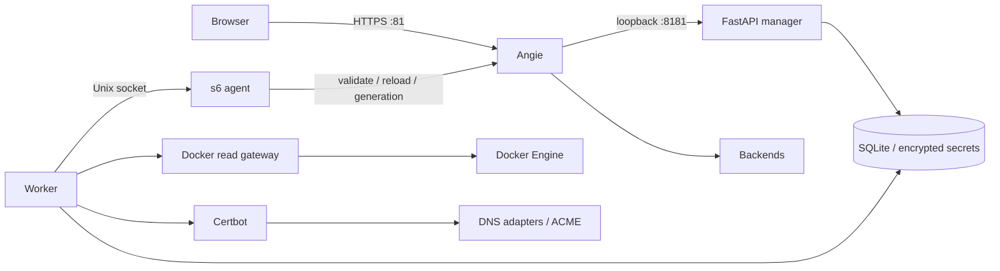

# Архитектура контрольной сборки

## Поток управления



Manager и worker используют один образ и общий сервисный слой. SQLite содержит желаемые ресурсы, историю конфигураций, задания, аудит и состояние интеграций. Агент работает в контейнере Angie и проверяет комплект тем же бинарным файлом, которым обслуживается трафик.

Все пути данных одинаковы в трёх контейнерах: `/data`. Angie работает в host network. Manager доступен через публикацию на loopback, worker общается с агентом через общий Unix socket. Docker socket монтируется только в шлюз; шлюз разрешает GET `_ping`, `version`, `containers/json` и `events`. Даже read-only bind mount сокета сам по себе не ограничивает Docker API — ограничение реализовано в обработчике шлюза.

## Существующий Angie

Самостоятельный `compose.existing.yaml` запускает manager/worker без сервиса Angie. В режиме `APM_ANGIE_MODE=existing` агент работает на хосте под systemd, использует указанные `APM_ANGIE_BINARY`, `APM_ANGIE_CONFIG`, `APM_ANGIE_PREFIX` и локальный status API. Данные смонтированы в контейнеры по тому же абсолютному пути, что и на хосте; Unix socket остаётся единственным управляющим транспортом.

Compiler формирует `http.conf` и `stream.conf` внутри каждой версии. Основной конфиг администратора содержит явные include из `current`; APM не создаёт глобальные процессы/PID, административный listener или default server. HTTP-политики и access logs APM задаются в его виртуальных хостах, сохраняя настройки остальных сайтов. Основной конфиг и его внешние зависимости не входят в backup APM.

Для `angie -t` агент создаёт временную копию основного конфига в той же директории и подставляет пути новой версии в две строки include. Так проверяются существующие и новые сайты с исходным prefix и относительными include, без изменения current. Затем выполняются обычные переключение, reload, подтверждение generation и откат. Подключение и ограничения описаны в [инструкции](EXISTING_ANGIE.md).

## Контракт API

Общая форма ресурса:

```json
{"name":"Application","enabled":true,"data":{"domains":["app.example.com"],"host":"10.0.0.20","port":8080}}
```

| Endpoint | Назначение |
|---|---|
| `POST /api/v1/auth/setup` | Первоначальный одноразовый setup |
| `POST /api/v1/auth/login`, `/mfa/verify` | Вход и второй фактор |
| `GET /api/v1/auth/me` | Текущий пользователь и CSRF |
| `POST /api/v1/auth/logout` | Отзыв сессии |
| `GET /api/v1/schemas/{kind}` | Типизированная схема формы |
| `GET/POST /api/v1/resources/{kind}` | Список и создание |
| `PUT/DELETE /api/v1/resources/{kind}/{id}` | Изменение/удаление с `If-Match` |
| `GET /api/v1/operations[/{id}]` | Статус долгих операций |
| `GET /api/v1/revisions` | История без секретов и приватных snapshot |
| `POST /api/v1/revisions/apply` | Повторная генерация текущего состояния |
| `GET /api/v1/capabilities` | Проверенные агентом возможности |
| `GET /api/v1/metrics`, `/logs/{kind}` | Наблюдаемость |
| `POST /api/v1/imports/preview` | Предварительный отчёт |
| `POST /api/v1/imports/{id}/activate`, `/drafts` | Активация либо выключенные черновики |
| `POST /api/v1/backups` | Создание зашифрованной копии |
| `GET /api/v1/backups/{id}/download` | Получение копии администратором |

Точные схемы и дополнительные действия доступны после входа администратора в `/api/docs`. Мутации требуют cookie-сессию и `X-CSRF-Token`; версия ресурса — `If-Match: N`. Ответ содержит `operation_id` и `revision_id`; это ещё не подтверждение reload.

HTML и REST используют одни сервисы и валидацию Pydantic. Роль проверяется на сервере, а не наличием кнопки. Административные политики нельзя удалить или заменить прямым запросом оператора. Привязка DNS-профиля к discovery задаётся администратором.

## Транзакции и применение

1. Изменение ресурса, приватный snapshot и apply-job фиксируются одной транзакцией.
2. SQLite write/check/write сериализуется `BEGIN IMMEDIATE`; `If-Match` дополнительно защищает от устаревшей формы.
3. Один worker выбирает задания в порядке постановки; одновременно работать двум worker не позволяет `flock`.
4. Compiler создаёт полный комплект; агент сохраняет его в отдельной неизменяемой директории с hash manifest.
5. `angie -t` выполняется до переключения `current`. Проверка и запуск используют одинаковый prefix.
6. Агент записывает журнал переключения, атомарно меняет symlink, делает reload и ждёт увеличения `generation` в локальном API.
7. После подтверждения создаётся receipt. Повтор команды для уже применённого комплекта идемпотентен.
8. При неудаче восстанавливается предыдущая версия. Неудачный откат сохраняет журнал и блокирует следующие apply; очистка DNS продолжает работать.

После перезапуска worker возвращает незавершённые задания в очередь и ставит уборку сохранённых challenge впереди новых операций. Перед следующим переключением агент восстанавливает незавершённый apply-журнал. Желаемое состояние и receipt применённого поколения остаются раздельными.

Пока подтверждение reload проверяет статус Angie и generation; контроль каждого настроенного backend, всей конфигурации и отказов внешних сервисов входит в оставшуюся приёмку. Падение backend не должно автоматически откатывать корректную административную конфигурацию без отдельной политики.

## Ключи и файлы

- `master.key`: Fernet-ключ вне SQLite, файл 0600; его создание сериализуется.
- `setup.token`: одноразовый файл 0600, удаляется после setup; токен отсутствует в HTTP API.
- `certificates/{id}/{hash}/`: нормализованная неизменяемая PEM-цепочка и закрытый ключ.
- `revisions/{id}/`: конфигурация, htpasswd, bouncer config и manifest; секретные snapshot не возвращаются через API.
- `acme/`: локальное состояние Certbot, журнал и сохранённые hooks; секрет EAB передаётся через временный 0600 config.
- `ech/{id}/{key-version}.pem`: ключ и ECHConfigList; новый ключ активируется после проверки DNS, предыдущий остаётся доступен.
- `geoip/{hash}/`: версионные Country/ASN MMDB.
- `exports/`: зашифрованные полные архивы. Пароль архива хранится отдельно; API его не возвращает.

Restore распаковывает только обычные файлы, проверяет пути и целостность SQLite. Swap выполняется внутри bind mount при остановленных процессах. Старое содержимое сохраняется в `.before-restore-*`; при прерывании остаётся `.restore-journal.json` для локального восстановления. Полностью автоматическое продолжение прерванного restore пока не реализовано.

## Образы

Обычный образ использует пакеты Angie 1.12.4. Расширенный Dockerfile собирает Angie и модули из `build/sources.lock.json`, включая OpenSSL ECH. Загрузка отсутствующего модуля не имитируется: compiler отклоняет требуемую функцию с причиной. MPTCP проверяется созданием сокета; QUIC BPF пока отключён до испытаний привилегированного Linux-профиля. Все полномочия root и произвольные snippets принадлежат доверенному администратору сервера.

Для Linux arm64 собраны manager и локальный Angie из закреплённого исходника. Пройдены изолированный existing smoke и полный Compose с s6, HTTP-маршрутом и отказом ошибочной конфигурации на Docker Desktop. `compose.local.yaml` использует bridge, общий named volume и backend `manager:8181` у worker и агента. Официальная базовая OCI-сборка Angie, расширенные модули, Linux host network, systemd и полная multiarch-поставка требуют отдельной приёмки.
