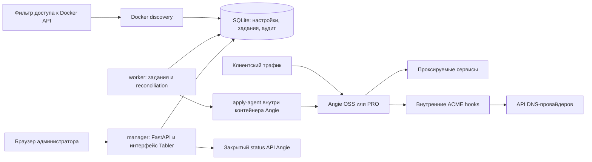

# План разработки панели управления Angie

Дата: 20 октября 2026 года. Статус: план по согласованным требованиям; разработка приложения ещё не начата.

## 1. Цель и согласованный объём

Публичный open-source проект: устанавливаемая на собственном сервере веб-панель для управления reverse proxy на Angie. Основной сценарий — один сервер и Docker Compose. Backend — Python + FastAPI; интерфейс — Tabler Core, Jinja2 и HTMX. Целевые редакции — бесплатная Angie и Angie PRO.

Полный первый релиз включает:

| Возможность | Состав |
| --- | --- |
| HTTP/HTTPS proxy hosts | Домены, backend, порты, WebSocket, маршруты по пути, включение и отключение |
| Сертификаты | Let's Encrypt HTTP-01 и DNS-01, wildcard, автоматическое продление, загрузка собственных сертификатов |
| Перенаправления | HTTP → HTTPS, перенаправления доменов и путей с выбором кода ответа |
| Ограничения доступа | IP/CIDR allow/deny, Basic Auth, явные правила их совместной работы |
| TCP/UDP | Прослушиваемый порт, протокол, целевой адрес и порт, проверка конфликтов |
| Мониторинг | Текущие метрики Angie, access/error logs, журнал действий панели |
| Пользователи | Администратор, оператор, наблюдатель |
| Docker labels | Автоматическое создание домена, маршрута и HTTPS по меткам контейнера |
| Дополнительные директивы | Редактирование разрешённых контекстов администратором, проверка и история изменений |
| Миграция из Nginx Proxy Manager | Желательная функция: предварительный просмотр импорта, отчёт о несовместимости, импорт поддерживаемых сущностей |

DNS-провайдеры: Webnames, Yandex, REG.RU, Selectel, Cloud.ru.

Дополнительно согласован ориентир развития — возможности NPMPlus. Они включены в дорожную карту расширений в разделе 14, после базового релиза. Для каждой группы определены этап и условия совместимости с Angie.

Отдельный интерфейс расширенной балансировки входит в дорожную карту NPMPlus; управление несколькими серверами остаётся дальнейшим расширением. Внутренние upstream-группы уже используются для маршрутизации и Docker discovery.

## 2. Выбранный стек

| Часть | Решение |
| --- | --- |
| Backend | Python + FastAPI, сервер Uvicorn |
| Схемы и валидация | Pydantic: общие модели ввода для API и форм |
| Интерфейс | Tabler Core HTML/CSS/JS, Tabler Icons, шаблоны Jinja2, HTMX |
| Данные | SQLite на локальном постоянном томе, SQLAlchemy 2, миграции Alembic |
| Аутентификация | Собственные модели пользователей, ролей и отзываемых серверных сессий; проверка прав через общие зависимости FastAPI |
| Фоновые операции | Отдельный Python worker и долговечные задания в БД |
| Интеграции | HTTP-клиент для Angie и DNS API; Docker discovery в worker |
| Проверки | pytest, интеграционные проверки с Angie и браузерные сценарии |
| Поставка | Docker Compose, закреплённые версии образов и зависимостей, CI |

### 2.1. Почему FastAPI

Оба разрешённых пользователем варианта позволяют реализовать продукт. Для этого проекта выбран FastAPI: общие схемы Pydantic, автоматическое описание OpenAPI и зависимости для проверки доступа уменьшают объём связующего кода вокруг API и интеграций. Ожидаемый выигрыш относится к разработке и сопровождению этой панели; он не является обещанием универсального преимущества в производительности. [Возможности FastAPI](https://fastapi.tiangolo.com/features/).

Flask удобен для небольшой синхронной HTML-панели. В данном проекте API, поток событий Docker, метрики и несколько внешних DNS-сервисов делают FastAPI более подходящей основой. Flask также поддерживает async views, но его документация описывает ограничения WSGI-модели и рекомендует очередь для фоновых задач. [Асинхронная работа Flask](https://flask.palletsprojects.com/en/stable/async-await/).

FastAPI позволяет отдавать HTML через Jinja2. HTML-обработчики и JSON API используют один сервисный слой, одну валидацию и одни правила доступа. HTMX обновляет формы, таблицы и статусы операций. [Шаблоны FastAPI](https://fastapi.tiangolo.com/advanced/templates/), [HTMX](https://htmx.org/docs/).

SQLAlchemy отвечает за модели и транзакции, Alembic — за миграции. Начальная реализация использует синхронный доступ к SQLite и короткие транзакции; блокирующие операции выполняются вне event loop. Применение конфигурации обслуживает один исполнитель. [SQLAlchemy ORM](https://docs.sqlalchemy.org/en/20/orm/quickstart.html), [Alembic](https://alembic.sqlalchemy.org/en/latest/).

Долговечные операции сохраняются в таблице заданий и выполняются worker с восстановлением после перезапуска. Механизм FastAPI `BackgroundTasks` не используется как хранилище таких заданий. Redis и Celery добавляются только при появлении обоснованной потребности.

Модуль аутентификации входит в первую alpha: хеширование паролей, случайный идентификатор сессии в HttpOnly/SameSite cookie с Secure при HTTPS, серверное хранение и отзыв сессий, CSRF-защита форм и cookie-auth API, ограничение попыток входа. Права проверяются во всех изменяющих обработчиках; HTML-компоненты входа из Tabler обеспечивают оформление.

Выбор поддерживаемой версии Python и точных версий зависимостей фиксируется в начале реализации.

### 2.2. Использование Tabler

Используется бесплатное ядро Tabler Core и подходящие иконки. Tabler предоставляет готовые HTML-компоненты на Bootstrap; исходные уведомления лицензии сохраняются в поставке. [Tabler Admin Template](https://tabler.io/admin-template), [лицензия Tabler Core](https://raw.githubusercontent.com/tabler/tabler/dev/LICENSE).

CSS, JavaScript, иконки и шрифты поставляются локально с приложением, чтобы интерфейс установки не зависел от внешнего CDN. Готовые собранные ресурсы позволяют начать интерфейс без отдельной сборки frontend. Подключение Tabler JS учитывает включённый Bootstrap, чтобы не загружать его повторно. [Установка Tabler](https://docs.tabler.io/ui/getting-started/installation).

Основной каркас — боковая навигация, адаптивная рабочая область, светлая и тёмная темы. Основные экраны:

- обзор состояния Angie, маршрутов, сертификатов и последних ошибок;
- proxy hosts и перенаправления: таблицы с фильтрами, статусами и действиями;
- редактор proxy host: основные параметры, пути, HTTPS, доступ, дополнительные директивы;
- TCP/UDP streams;
- сертификаты и DNS-профили;
- Docker discovery с источником объекта и конфликтами;
- логи и аудит;
- пользователи, роли, резервные копии и настройки.

На этапах расширения добавляются экраны политик TLS и заголовков, внешней авторизации, OIDC/MFA, CrowdSec, GeoIP, аналитики, групп upstream и статических сайтов/PHP. Возможности, которых нет в установленной сборке Angie, отображаются с причиной недоступности.

Графики и редактор директив подключаются небольшими локальными JS-компонентами по необходимости. Все ранее согласованные функции сохраняются в объёме базового полного релиза; расширения NPMPlus выпускаются по дорожной карте раздела 14.

## 3. Архитектура установки



Основные сервисы Compose:

1. `manager` — FastAPI, HTML-интерфейс Tabler и внутренние обработчики интеграций; работает без прав root.
2. `worker` — тот же образ приложения с другой командой запуска; выполняет фоновые задания.
3. `angie` — Angie и небольшой локальный исполнитель применения конфигураций.
4. Опциональный Docker API gateway — доступ только к необходимым операциям чтения списка, состояния и событий контейнеров.

Локальный исполнитель проверяет конфигурацию тем же бинарным файлом Angie, с теми же модулями и путями, с которыми работает сервер. Его внутренний API предоставляет ограниченные операции проверки, применения и получения результата. Формат запросов не допускает передачи произвольной shell-команды. Способ запуска и надзора за двумя процессами внутри контейнера Angie проверяется в техническом прототипе.

Постоянные данные: БД, ключ шифрования секретов, версии конфигураций, сертификаты и ACME-состояние, ограниченный набор журналов. В резервную копию входят все данные, необходимые для восстановления, включая ключ расшифрования; доступ к такой копии ограничен.

Клиентский трафик идёт через Angie. Остановка панели сохраняет уже работающие маршруты. Новые операции панели и ACME DNS hooks возобновляются после восстановления приложения; ошибки обновления сертификатов отображаются в интерфейсе.

## 4. Поддержка бесплатной Angie и PRO

Общий механизм управления — конфигурационные файлы, проверка и reload. Это позволяет реализовать одинаковые основные возможности для обеих редакций.

API бесплатной Angie используется для получения статуса и метрик. PRO API динамической конфигурации сейчас позволяет изменять отдельные серверы внутри upstream; его наличие не заменяет генерацию конфигурации proxy hosts. [API Angie](https://angie.software/angie/docs/configuration/modules/http/http_api/).

При подключении сервера панель определяет версию, редакцию и доступные модули. Возможности показываются на основании фактических возможностей установки. Для PRO предусматривается отдельный вариант сборки/подключения образа с лицензией владельца установки; параметры доступа к закрытому репозиторию не попадают в исходники, слои образа и логи. [Установка Angie](https://en.angie.software/angie/docs/installation/).

Приёмка обеих редакций требует настоящего прогона на OSS и лицензированной PRO. До такого прогона соответствующая совместимость обозначается как непроверенная. Поддерживаемая матрица версий фиксируется в README, а не формулируется как «все версии Angie».

## 5. Применение конфигурации

1. Проверить входные данные и права пользователя.
2. Сохранить желаемое состояние и задание с идентификатором версии в одной транзакции.
3. Сформировать полный неизменяемый набор файлов новой версии.
4. Проверить его через `angie -t` в окружении целевого Angie, включая все используемые файлы и сертификаты.
5. Под блокировкой переключить активную версию и выполнить reload.
6. Подтвердить загрузку версии по поколению конфигурации, состоянию сервера и контрольному запросу. Сам факт отправки сигнала не считается подтверждением.
7. Зафиксировать применённую версию; при ошибке восстановить файлы предыдущей рабочей версии и состояние задания. Если подтвердить откат нельзя, явно показать ошибку.

Статусы операции: `pending`, `validating`, `applying`, `applied`, `failed`, `rollback_failed`. В интерфейсе видны желаемая и фактически применённая версии. После аварийного завершения worker сопоставляет состояние БД, активных файлов и запущенного Angie до продолжения очереди.

Angie сам сохраняет старую рабочую конфигурацию, если reload не удаётся; панель дополнительно восстанавливает согласованное состояние файлов на диске и своей БД. [Управление Angie во время выполнения](https://angie.software/angie/docs/configuration/runtime/).

## 6. Сертификаты и DNS-провайдеры

Основной кандидат — встроенный ACME Angie: HTTP-01 для обычных доменов, DNS-01 через внутренние hooks для wildcard. Проверку выпуска и продления выполняем на техническом этапе; рабочие тесты сначала используют staging CA. У каждого сертификата один владелец жизненного цикла: встроенный ACME или импортированный сертификат. [ACME Angie](https://angie.software/angie/docs/configuration/acme/).

Общий Python-интерфейс DNS-адаптера:

- проверить учётные данные и найти зону;
- добавить конкретное значение TXT;
- дождаться появления значения на авторитетных DNS-серверах;
- удалить только добавленное значение;
- обработать истечение токена, временную ошибку, повторный вызов и ограничения API.

При одновременной проверке `example.com` и `*.example.com` могут потребоваться несколько TXT-значений с одним именем. Адаптер сохраняет чужие и параллельно используемые значения. На время изменения RRSet используются блокировки и доступные механизмы проверки версии/сравнения состояния провайдера.

| Провайдер | План подключения и ограничения исследования |
| --- | --- |
| Webnames | Проверить доступность документированного API для нужного типа аккаунта; реализовать добавление/удаление TXT и последовательную очередь запросов |
| Yandex | Рабочее допущение — Yandex Cloud DNS; реализовать авторизацию, обновление токенов и изменение RRSet |
| REG.RU | Проверить актуальные методы TXT, удаление конкретной записи и требования к доступу API на тестовом аккаунте |
| Selectel | Основной целевой вариант — актуальный DNS API v2; legacy API считается отдельной интеграцией |
| Cloud.ru | Рабочее допущение — Evolution DNS; Advanced DNS потребует отдельного адаптера |

У документированного партнёрского API Webnames есть запрет параллельных запросов и лимит 60 запросов за 30 минут; применимость интерфейса к обычным аккаунтам нужно подтвердить до фиксации реализации. [Webnames API](https://www.webnames.ru/partner/api).

У Yandex Cloud DNS документированы операции изменения RRSet, у Selectel — актуальный DNS API v2, у Cloud.ru Evolution — отдельный DNS API. Это подтверждает наличие интерфейсов интеграции, но не заменяет проверку выпуска wildcard на реальных тестовых зонах. [Yandex Cloud DNS](https://yandex.cloud/ru/docs/dns/api-ref/DnsZone/updateRecordSets), [Selectel DNS API](https://docs.selectel.ru/api/dns-actual/), [Cloud.ru Evolution DNS API](https://cloud.ru/docs/evolution-dns/ug/topics/api-ref).

Каждый провайдер считается поддержанным после проверки добавления/удаления TXT, выпуска и повторной проверки обновления wildcard, восстановления после ошибки. Для таких проверок потребуются тестовые зоны и учётные данные; секреты вводятся через защищённые настройки или secret-файлы установки.

## 7. Полная автоматизация Docker labels

Встроенный Docker-модуль Angie обновляет участников upstream на основе меток контейнеров. Для требуемого создания домена, маршрута и HTTPS панель реализует отдельный reconciler. [Docker-модуль Angie](https://angie.software/angie/docs/configuration/modules/http/http_docker/).

В первом варианте reconciler сам получает контейнеры и формирует желаемые маршруты. Один и тот же объект upstream имеет одного владельца обновлений, чтобы reconciler и встроенный Docker-модуль не меняли его одновременно.

Предварительная схема меток, подлежащая фиксации в спецификации:

```yaml
labels:
  apm.enable: "true"
  apm.host: "app.example.com"
  apm.port: "8080"
  apm.scheme: "http"
  apm.network: "proxy"
  apm.tls: "dns"
  apm.dns-profile: "primary-dns"
```

`dns-profile` — ссылка на заранее настроенные администратором учётные данные. Пароли и токены не помещаются в labels. Эти метки описывают маршрут reverse proxy; A/AAAA-записи домена по умолчанию настраиваются владельцем DNS. DNS-01 создаёт проверочные TXT-записи. Полное управление A/AAAA является отдельным расширением.

Поведение reconciler:

- первоначальное чтение состояния, подписка на события, периодическое повторное сопоставление;
- создание маршрута и запроса HTTPS только при явном `enable`;
- выбор Docker-сети и порта по меткам;
- объединение коротких серий событий в одно применение;
- идемпотентность, сохранение владельца объекта и обнаружение конфликтов доменов;
- при конфликте с ручным маршрутом — ошибка без перезаписи;
- при остановке контейнера — отключение его маршрута с сохранением настроек и сертификата;
- после удаления контейнера — отметка отсутствующего источника и очистка по явно заданной политике;
- изменения объекта из labels выполняются в исходных метках; ручной перевод в управление панелью оформляется отдельным действием.

Создание маршрута из labels ограничивается разрешёнными сетями, доменными зонами и DNS-профилями. Разрешение запускать контейнеры само по себе не даёт права использовать любой DNS-токен панели. Доступ к Docker API ограничивается фильтрующим gateway; bind-mount сокета с `:ro` не считается ограничением методов API. [Защита Docker API](https://docs.docker.com/engine/security/protect-access/).

## 8. Роли и дополнительные директивы

| Действие | Администратор | Оператор | Наблюдатель |
| --- | --- | --- | --- |
| Просмотр маршрутов, статуса и доступных логов | Да | Да | Да |
| Изменение обычных маршрутов и списков доступа | Да | Да | Нет |
| Выбор уже разрешённого сертификата или TLS-профиля | Да | Да | Нет |
| Пользователи, роли, DNS-токены, глобальные настройки | Да | Нет | Нет |
| Произвольные директивы Angie | Да | Нет | Нет |
| Импорт, восстановление, настройка Docker discovery | Да | Нет | Нет |

Проверки выполняются на сервере для каждого изменения. DNS-токены и закрытые ключи не возвращаются в обычных ответах и не записываются в аудит. Чувствительные поля журналов маскируются, а доступ к журналам учитывает роль.

Дополнительные директивы привязываются к конкретным контекстам: `http`, `server`, `location`, `stream`. Редактор показывает контекст, diff и результат проверки. Текст не выполняется как шаблон приложения. Изменение глобальных блоков и файловых путей — полномочие администратора; проверка синтаксиса не трактуется как изоляция небезопасных директив. Если оператор редактирует объект с административным snippet, отдельные права защищают snippet от изменения.

## 9. Миграция из Nginx Proxy Manager и NPMPlus

Импорт — отдельный модуль с поддерживаемой матрицей версий исходной схемы.

1. Зафиксировать формат входа: первая цель — согласованный снимок SQLite и архив необходимых файлов; для MariaDB предусмотреть отдельный экспортёр.
2. Читать данные без изменения исходной установки.
3. Построить предварительный отчёт: proxy hosts, redirects, streams, списки доступа, сертификаты, конфликты и неподдерживаемые параметры.
4. Сопоставить параметры с моделью панели; произвольные директивы помечать для проверки администратором.
5. Создать черновики и проверить полный конфигурационный набор до активации.
6. Импортировать сертификаты с проверкой ключей, цепочек и путей; выбрать момент передачи управления продлением.
7. Создать новые учётные записи/процедуру сброса доступа; переносимость паролей не предполагается без отдельной проверки.
8. После переключения HTTP/HTTPS-портов выполнить smoke-проверку и иметь путь возврата к исходной установке.

Два менеджера не должны одновременно обслуживать одни и те же порты или продлевать один и тот же сертификат. Отчёт импорта явно показывает, какие настройки требуют ручной доработки.

Для NPMPlus предусматривается отдельный адаптер исходной схемы. По мере реализации раздела 14 он сопоставляет дополнительные политики и связи с моделью панели. Объекты с ещё неподдерживаемой защитой, авторизацией или mTLS остаются неактивными и попадают в отчёт: импорт не должен незаметно публиковать сервис с ослабленным доступом. Сессии, зашифрованные секреты и подключения OIDC восстанавливаются через настройку в новой панели. Номер версии NPMPlus и формат снимка фиксируются в матрице импортёра.

## 10. Этапы и оценка трудозатрат

Оценка предварительная, для одного опытного разработчика с полной занятостью. Она предполагает доступ к тестовым DNS-зонам и лицензированной Angie PRO. Это ориентир планирования, а не обещание даты выпуска.

| Этап | Состав | Трудозатраты | Критерий завершения |
| --- | --- | --- | --- |
| A. Техническая основа | Репозиторий, FastAPI, модели SQLAlchemy и миграции Alembic, Compose, определение возможностей Angie, прототип проверки/reload/отката, один ACME hook | 2–3 рабочих дня | Изменение тестового маршрута и ошибочная конфигурация проверены на настоящем Angie |
| B. Ранняя alpha | Интерфейс Tabler/Jinja2/HTMX, вход, серверные сессии и CSRF, роли, HTTP/HTTPS, WebSocket, перенаправления, HTTP-01, собственные сертификаты, история применения | 5–7 дней | Чистая установка и рабочий HTTPS-маршрут через браузер |
| C. Администрирование | IP/CIDR и Basic Auth, TCP/UDP, дополнительные директивы администратора, логи и текущие метрики | 5–8 дней | Все перечисленные функции проходят сценарии UI и интеграционные проверки |
| D. DNS и автоматизация | Единый DNS-слой, пять адаптеров, wildcard, Docker labels и reconciliation | 10–15 дней | Для каждого провайдера проверен wildcard; контейнер по меткам получает маршрут и HTTPS |
| E. Импорт и релиз | Импорт NPM поддерживаемой схемы, backup/restore, обновление, матрица OSS/PRO, документация, упаковка | 5–8 дней | Воспроизводимая установка, миграция и восстановление подтверждены |

Первая полезная alpha: ориентировочно 7–10 рабочих дней от старта. Суммарная базовая оценка этапов A–E: 27–41 рабочий день. С резервом на интеграции и обратную связь — примерно 7–11 недель для базового полного релиза. Ожидание внешних доступов может увеличить календарный срок. Выбор готового Tabler ускоряет оформление интерфейса; оценка сохраняет работы по сессиям, CSRF и правам, которые теперь реализуются модулем приложения.

Эта оценка не включает дополнительные группы NPMPlus из раздела 14 и адаптер импорта его расширенных настроек. Они входят в общий план продукта и оцениваются отдельно после прототипов CrowdSec и расширенного TLS. Ранняя alpha сохраняет прежний состав.

Все обязательные функции сохраняются в цели полного первого релиза. Ранняя alpha позволяет начать пользоваться основными сценариями до завершения пяти DNS-интеграций и полной автоматизации.

## 11. Проверки перед полным релизом

- Чистая установка Compose, первый администратор, вход по HTTPS и смена пароля.
- HTTP/HTTPS, WebSocket, маршруты по пути и перенаправления.
- Ожидаемая совместная работа IP/CIDR и Basic Auth; проверка доверенных proxy и реального IP клиента.
- TCP и UDP на реальных тестовых сервисах; обнаружение конфликтов портов и отдельная документация публикации stream-портов в Compose.
- Ошибка синтаксиса, ошибка открытия ресурса при reload, конкурентные изменения, аварийное завершение на каждом шаге применения.
- Подтверждение фактически загруженного поколения конфигурации и восстановления последней рабочей версии.
- Получение и повторная проверка обновления сертификата, сбой DNS API, истечение токена, несколько TXT-значений, очистка только своих записей.
- Жизненный цикл Docker-контейнера, потеря потока событий, повторное сопоставление, конфликт ручного и автоматического маршрутов.
- Запрет оператору менять snippets, DNS-секреты и пользователей; запрет наблюдателю выполнять мутации через прямые запросы.
- Backup/restore на чистую установку и обновление схемы БД с резервной копией.
- Матрица совместимости OSS/PRO; выпуск образов только для действительно проверенных платформ.
- Лимиты хранения логов и рядов метрик; история метрик хранится агрегированно и не превращает SQLite в хранилище сырых access logs.

## 12. Первые задачи разработки

1. Создать структуру FastAPI-приложения, настройки, SQLAlchemy/Alembic, модели пользователей/ролей/сессий и Compose; подключить локальные ресурсы Tabler, Jinja2 и HTMX.
2. Зафиксировать одну базовую версию Angie и формат определения возможностей.
3. Реализовать модели `ProxyHost`, `RedirectHost`, `StreamHost`, `AccessList`, `Certificate`, `DnsProfile`, `ConfigRevision`, `ApplyJob`, `DockerSource`, `AuditEvent`.
4. Реализовать первый полный сценарий: форма домена → БД → конфигурация → `angie -t` → reload → подтверждение → статус в UI.
5. Проверить ошибочный конфиг и восстановление после аварийного завершения.
6. Подключить HTTP-01 и собственный сертификат.
7. На одном DNS-провайдере проверить контракт hooks и полный цикл wildcard; затем подключать остальные адаптеры.

## 13. Оставшиеся уточнения и зависимости

- Для `Yandex` принято допущение Yandex Cloud DNS; для `Cloud.ru` — Evolution DNS. Другие продукты потребуют отдельного адаптера и оценки.
- Для Selectel целевой вариант — актуальный API v2.
- Приоритет подключения DNS-провайдеров не задан; первым выбирается провайдер с доступной тестовой зоной, остальные входят в полный релиз.
- Для NPM требуется определить исходную версию и тип БД перед реализацией конкретного импортёра.
- Поддержка PRO подтверждается после предоставления тестового окружения с лицензией.
- Название и лицензия open-source проекта выбираются до публикации репозитория. Рабочее название этого документа не является утверждённым названием продукта.
- Подтверждено только планирование. Публикация репозитория и развёртывание приложения не выполнялись.

## 14. Расширения по ориентиру NPMPlus

### 14.1. Ориентир и порядок выпуска

На 20 октября 2026 года изучены [README NPMPlus](https://github.com/ZoeyVid/NPMplus/blob/develop/README.md) и [параметры Compose](https://github.com/ZoeyVid/NPMplus/blob/develop/compose.yaml). В дорожную карту включены транспорт, политики доступа, внешняя авторизация, защита, аналитика и эксплуатационные настройки. Это план реализации эквивалентных пользовательских сценариев на FastAPI и Angie.

Перед реализацией фиксируется конкретный tag/commit референса и составляется проверяемая матрица UI/API. Текущий обзор документации не означает подтверждённого полного совпадения с каждой внутренней настройкой NPMPlus.

- **База, этапы A–E:** ранее выбранные функции, Tabler, роли, пять DNS-провайдеров и Docker labels. HTTPS панели, CSRF, серверные сессии, аудит и права входят в базу.
- **N1 — маршрутизация и политики:** HTTP/3, расширенные маршруты и upstream, mTLS, ACL по location, TLS/ACME и заголовки, сжатие, буферизация, IDN.
- **N2 — авторизация, защита и аналитика:** OIDC/MFA, внешние провайдеры доступа, CrowdSec/AppSec, bot protection, GeoIP, GoAccess и импорт расширений NPMPlus.
- **N3 — специальные сборки и эксплуатация:** ECH, сжатие сертификатов, расширенные модули, сетевые оптимизации и сценарии запуска. Для возможностей, зависящих от TLS-библиотеки или ядра ОС, сначала проводится исследование и эксперимент.

Решения о переносе отдельных небольших возможностей раньше принимаются без удаления согласованного объёма базового релиза. Все группы ниже остаются частью общего плана.

### 14.2. Матрица расширений

| ID | Группа возможностей | Что реализуем в панели | Этап |
| --- | --- | --- | --- |
| NP01 | HTTP/2, HTTP/3/QUIC | Настройки протоколов на host, публикация UDP, Alt-Svc, контроль отката на доступный протокол | N1 |
| NP02 | gRPC/gRPCS | Тип маршрута, upstream TLS, SNI, проверка CA и настройки длительных соединений | N1 |
| NP03 | PROXY protocol, stream TLS | Раздельные входной/исходящий режимы; завершение TLS, повторное TLS-соединение с backend, проверка источника и сертификата | N1 |
| NP04 | Upstream-группы | Несколько backend, веса, backup, переключение состояния, связь с HTTP/gRPC/stream и профилями авторизации | N1 |
| NP05 | Статика, PHP, индекс каталога | Каталог сайта из разрешённого тома, поведение index/root/alias, внешний PHP-FPM; отдельный профиль поставки PHP; красивый индекс | N1; дополнительные сборки N3 |
| NP06 | ACL на host/location | Несколько списков, явный порядок, наследование и объединение IP/Basic Auth; предварительный просмотр итогового правила | N1 |
| NP07 | auth_request | Профили Authelia, Authentik, OAuth2 Proxy, Tinyauth, VoidAuth; переопределение на location, передача разрешённых identity-заголовков | N2 |
| NP08 | OIDC панели, MFA | Вход через IdP, привязка идентичности, TOTP, recovery codes и локальная команда восстановления доступа | N2 |
| NP09 | CrowdSec | Подключение LAPI, применение решений, исключения, состояние связи и контролируемое поведение при сбое | N2 |
| NP10 | AppSec/WAF, bot protection | AppSec на host/location, режим наблюдения и блокировки, CAPTCHA/challenge; профиль Anubis через auth_request | N2 |
| NP11 | Заголовки и noindex | Профили CSP/HSTS и других заголовков, скрытие служебной информации, управление X-Frame-Options, правила индексирования и User-Agent | N1 |
| NP12 | Лимиты и буферизация | Ограничение частоты и соединений, upload size, таймауты, отдельные request/response buffering, совместимость с AppSec | N1; связка с AppSec N2 |
| NP13 | Gzip, Brotli, Zstd | Выбор алгоритмов и типов содержимого, готовые сжатые файлы, политика сжатия ответов backend | N1 |
| NP14 | ACME и собственные сертификаты | Настраиваемые CA, EAB, профили и сроки, RSA/ECDSA, политика ключей и продления, замена существующего сертификата | N1 |
| NP15 | mTLS | Клиентские CA на host, режим проверки, отзыв и срок действия, передача идентичности в разрешённых заголовках | N1 |
| NP16 | TLS-политики, OCSP | Версии TLS, шифры и группы, включая гибридные/PQ при поддержке библиотеки и клиентов; stapling/Must-Staple при поддержке CA и клиента ACME | N1; специальные сборки N3 |
| NP17 | ECH, сжатие сертификатов | Жизненный цикл ECH-ключей, DNS HTTPS records, проверка действующего ключа; отдельная проверка совместимости загрузки сертификатов | N3 |
| NP18 | Real IP, доверенные proxy | CIDR доверенных источников, выбор заголовка/PROXY protocol, обновляемый список Cloudflare по явному включению | N1 |
| NP19 | GeoIP | Правила по стране/ASN, исключения для локальных адресов, обновление MMDB и отображение актуальности данных | N2 |
| NP20 | GoAccess, API docs | Защищённая аналитика по журналам, сроки хранения и маскирование IP; документация API с проверкой доступа | База API; GoAccess N2 |
| NP21 | Управление логами | Access logging по включению, ротация, сроки хранения, redaction, отдельные политики HTTP/stream и обязательного аудита изменений | База; расширение N1 |
| NP22 | IDN, default/dead hosts | Нормализация Unicode/Punycode, ответы для неизвестного host, варианты 404/444, redirect и собственная HTML-страница | N1 |
| NP23 | Runtime и модули | Адреса/порты, IPv4/IPv6, workers/connections, целевые профили NJS/Lua/GeoIP2/LDAP/NTLM/VTS с проверкой поддержки и профили запуска с PUID/PGID | База частично; N3 |
| NP24 | Дополнительные настройки поставки | Проверки MPTCP и QUIC BPF, amd64/arm64, setup wizard, локальная диагностика доступности backend, CLI восстановления, pre-run hooks из файлов развёртывания | База частично; N3 |
| NP25 | Импорт NPMPlus | Версионный адаптер, mapping политик и связей, отчёт, сохранение ограничений доступа, контрольное переключение | N2 |

Пункты таблицы — требования к нашей реализации и её проверкам. Конкретные значения по умолчанию выбираются по совместимости с Angie и целевыми клиентами. Параметры референса не становятся автоматически значениями нашей установки.

### 14.3. Подтверждённая основа Angie и технические проверки

**Транспорт.** В документации Angie есть [HTTP/3](https://angie.software/angie/docs/configuration/modules/http/http_v3/) и [gRPC](https://angie.software/angie/docs/configuration/modules/http/http_grpc/). Приёмка NP01–NP03 проверяет фактические запросы, публикацию TCP/UDP и взаимодействие с доверенными proxy. Возможность конкретной конфигурации определяется сборкой и окружением; HTTP PROXY listener и QUIC не считаются автоматически совместимыми.

**Внешняя авторизация.** Для NP07 используется [Auth Request Angie](https://angie.software/angie/docs/configuration/modules/http/http_auth_request/). Авторизация проксируемого приложения и вход в саму панель — отдельные настройки. Для OIDC требуется проверка issuer, audience, state, nonce, срока токена и redirect URI. Администратор явно задаёт соответствие внешней идентичности и локальной роли; совпадения email недостаточно для выдачи административных прав.

**CrowdSec.** Кандидат интеграции — Lua bouncer и отдельный контейнер Security Engine/AppSec. Angie предоставляет [Lua-модули](https://en.angie.software/angie/docs/configuration/modules/external-modules/lua/index.html), однако совместимость bouncer с выбранными OSS/PRO-образами подтверждается отдельным прототипом. Сначала проверяются решения LAPI и блокировка IP, затем проверка запросов и challenge. FastAPI не включается в путь каждого пользовательского запроса. [Архитектура CrowdSec bouncer](https://docs.crowdsec.net/docs/next/bouncers/nginx/).

При включении AppSec панель учитывает конфликты с отключённой буферизацией и проверкой тела запроса. В тесты включаются HTTP/1.1, HTTP/2 и HTTP/3, тела без Content-Length, загрузки больших файлов и streaming. Поведение при недоступности LAPI/AppSec задаётся явно на уровне политики. Наличие блокировки IP не считается доказательством работающего WAF.

**Модули.** Brotli, Zstd, GeoIP2, Lua и Headers More доступны в экосистеме пакетов Angie. Наличие пакета, его загрузка и работоспособность в конкретном образе фиксируются отдельно. Fancyindex рассматривается как дополнительная сборка: документация Angie приводит его как пример модуля, отсутствующего в стандартном перечне. [Пакеты и сборка сторонних модулей](https://angie.software/angie/docs/installation/external-modules/), [Docker-образы Angie](https://angie.software/angie/docs/installation/docker/).

**TLS и ECH.** Angie документирует ECH начиная с 1.11.0, но для работы нужна подходящая TLS-библиотека. Поэтому N3 включает проверку образа, генерацию и ротацию ключей, DNS-публикацию и реальный тест клиента. Отсутствие поддержки отображается явно. [ECH в Angie](https://angie.software/angie/docs/configuration/modules/http/http_ssl/#ssl-encrypted-hello-key).

Есть отдельное ограничение выбранного ACME-пути: сертификаты, загружаемые через переменные, не используют OCSP stapling и сжатие сертификатов. Для NP16–NP17 проверяем способ загрузки и обновления сертификатов. Если потребуется внешний ACME-клиент, это альтернативный backend для конкретного сертификата с единственным владельцем продления. [Загрузка и сжатие сертификатов Angie](https://angie.software/angie/docs/configuration/modules/http/http_ssl/).

Профили short-lived CA должны менять расписание проверок и окно продления с учётом срока сертификата. Поддержка DNS-01 через TXT не доказывает возможность записи HTTPS/SVCB для ECH: у DNS-адаптеров добавляется отдельная проверяемая возможность `https_records`. Первые пять провайдеров остаются согласованными; дополнительные провайдеры подключаются тем же интерфейсом.

**Статика и PHP.** Разрешённые document roots задаются администратором через отдельные тома. Пользователь формы не получает доступ ко всем файлам контейнера. Для PHP предусматривается отдельный FPM-сервис; вариант встроенного раннера относится к специальному профилю поставки и отдельной оценке. Backend панели остаётся Python.

**Экспертные настройки.** Дополнительные модули включаются из проверенного каталога образа. Pre-run hooks задаются владельцем установки как смонтированные файлы и выключены по умолчанию. Сетевые оптимизации показываются только после проверки ядра и доступных возможностей контейнера. Универсальный запуск shell-команд из веб-панели не добавляется.

### 14.4. Дополнения к модели данных и интерфейсу

В техническом проекте закладываются сущности `RoutePolicy`, `HeaderPolicy`, `TlsPolicy`, `ClientCA`, `UpstreamGroup`, `AuthProvider`, `OidcProvider`, `MfaCredential`, `CrowdSecProfile`, `GeoIpPolicy`, `SiteRoot` и `FeatureCapability`. Конкретные таблицы добавляются миграциями по мере реализации групп N1–N3.

Настройки привязываются к host/location и имеют определённые правила наследования. UI показывает итоговые параметры, источник наследования, конфликты и требования к модулю. Наличие записи в БД или переключателя в Tabler не означает, что функция активна: статус подтверждает применённая конфигурация и проверка.

Для аналитики доступ GoAccess защищается той же сессией и правами, что и панель. Access logs включаются явно; CrowdSec и GoAccess показывают зависимость от них. Даже при выключенных access logs журнал изменений панели сохраняется по своей политике. Аналитические sidecar-сервисы не получают DNS-токены, ключи сертификатов и доступ на запись к конфигурации Angie.

### 14.5. Приёмка и влияние на сроки

Для каждого NP-пункта создаётся задача со ссылкой на зафиксированную версию референса, ожидаемым поведением UI/API, зависимостями, тестом OSS/PRO и статусом: `planned`, `prototype`, `verified` или `unavailable_in_build`.

Контрольные сценарии расширений:

- реальный HTTP/3 и gRPC-запрос, переключение backend, отсутствие потери существующих маршрутов;
- порядок нескольких ACL, наследование location и отсутствие обхода через доверенные заголовки;
- успешный и запрещённый mTLS-доступ, истёкший сертификат и отзыв клиента;
- OIDC login/logout, проверка ошибочного issuer/state, MFA и восстановление через локальную CLI;
- блокировка тестового IP, срабатывание AppSec, исключения и недоступность защитного сервиса;
- обновление GeoIP/MMDB, разбор логов аналитикой и соблюдение сроков хранения;
- выпуск и продление сертификата выбранной CA, замена собственного сертификата, применимость TLS-политики;
- для ECH — ротация ключа, актуальность DNS HTTPS record и подключение поддерживающего клиента;
- импорт NPMPlus с сохранением настроек авторизации, mTLS, заголовков и списком несовместимых объектов.

Оценка 7–11 недель из раздела 10 относится к базовому релизу. N1, N2 и N3 выпускаются последовательно после него; срок полной функциональной близости NPMPlus уточняется после прототипов и матрицы сборок. ECH, CrowdSec и нестандартные модули не получают обещанный срок до подтверждения выбранного способа интеграции.
